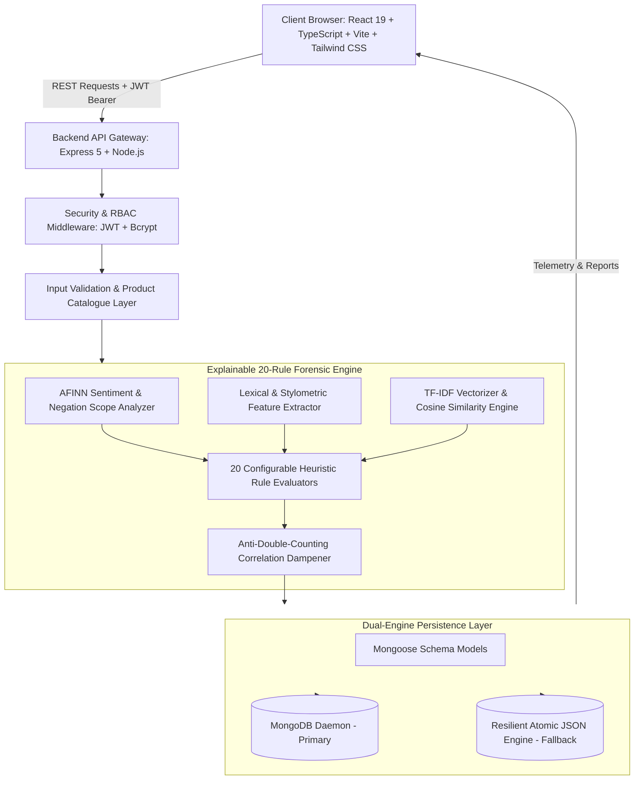

# ReviewGuard AI — Intelligent Fake Review Detection & Review Forensics System

> **Academic Engineering Capstone Project**  
> *An explainable full-stack review forensics platform integrating 20 weighted heuristic indicators, correlation-dampened scoring, AFINN sentiment polarity with negation scope, cross-review TF-IDF cosine similarity clustering, temporal burst campaign detection, and role-based access control.*

---

## 1. Project Overview & Objective

Consumer review systems are frequently corrupted by coordinated astroturfing syndicates, AI-generated synthetic feedback, paid reviewer circles, and review inversion attacks. Conventional black-box supervised machine learning models (e.g., SVMs, neural classifiers) produce arbitrary probability estimates that cannot be traced to concrete textual evidence, struggle with domain transfer across divergent product categories, and expose organizations to legal ambiguity.

**ReviewGuard AI** solves this problem through **transparent, explainable forensics**. Rather than outputting an opaque label, ReviewGuard AI evaluates 20 empirical heuristic indicators, extracts lexical and stylometric features, evaluates sentiment-rating consistency, and computes a bounded **Heuristic Risk Score (0–100)** equipped with **anti-double-counting correlation dampening**.

### Critical Academic Framing
- **Heuristic Risk Assessment vs. Verified Fraud**: A high risk score indicates the presence of suspicious, inorganic, or anomalous patterns; it is **not** definitive legal proof of fraud. Conversely, a zero risk score indicates that no known heuristic anomalies were detected, which does not guarantee authenticity.
- **Explainability First**: Every analysis produces an itemized audit across all 20 rules (both triggered and clean), reporting base weights, effective contributions, and text evidence snippets.

---

## 2. System Architecture



---

## 3. Technology Stack

| Layer | Technologies & Libraries |
| :--- | :--- |
| **Frontend** | React 19, TypeScript, Vite, Tailwind CSS, Lucide React, Recharts (Responsive Container, BarChart, PieChart, AreaChart, Tooltip) |
| **Backend** | Node.js (v20+ / v24), Express 5, Multer (file upload), CSV-Parser |
| **Database** | MongoDB with formal Mongoose schemas; automated resilient fallback to atomic persistent file storage (`data/reviewguard_db.json`) |
| **Security** | Bcrypt (10 salt rounds), JSON Web Tokens (JWT), Role-Based Access Control (`admin`, `analyst`), sanitized diagnostics |
| **Forensics** | AFINN Sentiment Lexicon, N-Gram tokenization, TF-IDF vectorization, Cosine Similarity, MD5 text hashing, Connected Components clustering |
| **Testing** | Node.js native test runner (`node --test`), automated unit and integration suites |

---

## 4. Detection Methodology & Score Calculation

### 4.1 The 20 Forensic Heuristic Indicators

| Rule ID | Indicator Name | Family Group | Base Weight | Severity | Trigger Criteria |
| :--- | :--- | :--- | :---: | :---: | :--- |
| `RULE_01` | Rating–Sentiment Inconsistency | `SENTIMENT` | 20 | High | Discrepancy between star rating and sentiment polarity (e.g., 1★ review with glowing praise, or 5★ review containing negative critique). |
| `RULE_02` | Promotional and Spam Language | `COMMERCIAL` | 18 | High | Advertising buzzwords, affiliate promo codes, or commercial guarantees (*100% recommended*, *satisfaction guaranteed*). |
| `RULE_03` | Repeated Words and Phrases | `SYNTACTIC` | 14 | Medium | Consecutive identical words or repetitive sentence phrases (*buy now buy now buy now*). |
| `RULE_04` | Excessive Capitalization | `STYLOMETRIC` | 10 | Low | High proportion of uppercase characters (shout-style text ≥ 35% uppercase in reviews ≥ 25 characters). |
| `RULE_05` | Excessive Punctuation Marks | `STYLOMETRIC` | 8 | Low | Extreme punctuation density (≥ 4 exclamation points, question chains, or repetitive ellipses). |
| `RULE_06` | Hollow & Generic Superlatives | `RHETORICAL` | 14 | Medium | Ungrounded, hyperbolic praise (*miracle*, *life-changing*, *holy grail*, *best in the universe*) lacking experiential detail. |
| `RULE_07` | Low-Information Generic Review | `RHETORICAL` | 12 | Medium | Terse, non-specific remarks (*good product very nice*) devoid of product-specific functional attributes. |
| `RULE_08` | Absolute & Unrealistic Claims | `RHETORICAL` | 12 | Medium | Unconditional guarantees (*works instantly 100% of the time*, *zero flaws impossible to break*). |
| `RULE_09` | Keyword Stuffing & Over-Mention | `COMMERCIAL` | 15 | High | Unnatural repetition of exact product model numbers and brand keywords. |
| `RULE_10` | Incompatible Category Terms | `DOMAIN` | 16 | High | Discussion of attributes foreign to the declared product category (e.g., discussing *flavor* in Electronics or *battery life* in Fashion). |
| `RULE_11` | Reviewer Uniform Rating History | `BEHAVIORAL` | 12 | Medium | Historical reviewer standard deviation of ratings is zero (e.g., 100% 5-star submissions across ≥ 4 reviews). |
| `RULE_12` | Reviewer Velocity Burst | `TEMPORAL` | 18 | High | Unusually rapid submission volume by the same account (≥ 5 reviews in a compressed timeframe). |
| `RULE_13` | Call-to-Action Directives | `COMMERCIAL` | 16 | High | Direct imperatives urging the reader to buy immediately (*buy now*, *run to buy*, *don't hesitate*). |
| `RULE_14` | Unusual Review-Length Patterns | `STYLOMETRIC` | 8 | Low | Review length sitting on extreme tails (< 20 characters or > 2500 characters). |
| `RULE_15` | Exact Duplicate Reviews | `SYNDICATION` | 35 | Critical | 100% byte-for-byte MD5 hash match against existing stored review corpus. |
| `RULE_16` | Near-Duplicate Reviews | `SYNDICATION` | 24 | High | TF-IDF Cosine & N-Gram Jaccard similarity ≥ 70% against existing records. |
| `RULE_17` | Repeated Templates Across Products | `SYNDICATION` | 22 | High | The same reviewer submitting nearly identical review bodies across unrelated products. |
| `RULE_18` | Reviewer Rating Deviation | `BEHAVIORAL` | 14 | Medium | Historical divergence where reviewer's rating sits on extreme tails compared to product average. |
| `RULE_19` | Product Review Velocity Burst | `CAMPAIGN` | 20 | High | A sudden influx of positive reviews for the same product within 24–48 hours. |
| `RULE_20` | Cross-Reviewer Syndicate Language | `SYNDICATION` | 22 | High | Different reviewer accounts submitting near-identical review text (sockpuppet syndicate marker). |

---

### 4.2 Anti-Double-Counting Correlation Dampening

In naive additive scoring, a single sentence such as *"BUY NOW SPECIAL DISCOUNT BEST DEAL EVER!!!"* could trigger Rules 02, 04, 05, and 13 simultaneously, artificially inflating the score beyond 60 points.

To prevent inflated scores from correlated linguistic markers, ReviewGuard AI groups triggered rules by **thematic family**:
1. Within each family, rules are sorted by base weight in descending order.
2. Dampening coefficients are applied sub-additively:
   - **1st Rule in Family**: $1.00 \times \text{Weight}$ (100% contribution)
   - **2nd Rule in Family**: $0.60 \times \text{Weight}$ (60% contribution)
   - **3rd Rule in Family**: $0.35 \times \text{Weight}$ (35% contribution)
   - **4th+ Rule in Family**: $0.20 \times \text{Weight}$ (20% contribution)
3. The raw dampened score is summed and bounded to $[0, 100]$.

$$\text{Risk Score} = \min\left(100, \sum_{g \in \text{Groups}} \sum_{i=1}^{n_g} w_{g,i} \cdot \delta_i \right)$$

where $\delta = [1.0, 0.60, 0.35, 0.20]$.

---

### 4.3 Risk Bands & Academic Classifications

The final score maps deterministically to 4 configurable risk bands:

| Risk Score | Risk Level | Cautious Academic Assessment Label | Interpretation & Suggested Action |
| :---: | :---: | :--- | :--- |
| **0 – 24** | **Low** | `LOW RISK — Appears Genuine` | Review exhibits organic linguistic and stylometric characteristics. Baseline organic consumer feedback. |
| **25 – 49** | **Moderate** | `MODERATE RISK — Needs Review` | Mild stylistic anomalies or isolated marketing markers detected. Human verification recommended. |
| **50 – 74** | **High** | `HIGH RISK — Suspicious Patterns Detected` | Multiple forensic rules triggered across distinct thematic groups. Heightened likelihood of non-organic origin. |
| **75 – 100** | **Very High** | `VERY HIGH RISK — Strongly Suspicious` | Critical indicators detected (e.g., duplicate syndication, template reuse, severe rating-sentiment contradiction). |

---

## 5. Database Architecture & Persistence Schemas

ReviewGuard AI defines strict Mongoose schemas implemented in `backend/src/models/schemas.js` and managed through `backend/src/db.js`.

### 5.1 Collections

1. **`Review` (`reviews`)**:
   - `product_name` (String, required, indexed)
   - `product_id` (String, indexed)
   - `category` (String, enum: Electronics, Fashion, Beauty, Home/Kitchen, Grocery, Books, Sports, Other)
   - `platform` (String, enum: Amazon, Flipkart, Google Reviews, Trustpilot, App Store, Direct E-Commerce, Web)
   - `reviewer_name` (String, required)
   - `reviewer_id` (String, indexed)
   - `rating` (Number, 1–5, required)
   - `headline` (String)
   - `review_text` (String, required)
   - `review_date` (Date)
   - `risk_score` (Number, 0–100)
   - `risk_level` (String: Low, Moderate, High, Very High)
   - `assessment` (String)
   - `classification_label` (String)
   - `rule_engine_version` (String)
   - `sentiment_analysis` (Object: label, score, positive_words, negative_words, rating_consistency)
   - `triggered_rules` (Array of triggered rule objects)
   - `all_rules_audit` (Array of all 20 evaluated rules, with status, weights, contributions, and evidence)
   - `lexical_metrics` (Object: word_count, char_count, uppercase_ratio, punctuation_ratio, exclamation_count)
   - `duplicate_forensics` (Object: text_hash, is_exact_duplicate, is_near_duplicate, highest_similarity_score, matched_review)
   - `reviewer_forensics` (Object: has_sufficient_history, history_count, avg_historical_rating)
   - `createdAt`, `updatedAt` (Timestamps)

2. **`User` (`users`)**:
   - `username` (String, unique, required)
   - `email` (String, unique, lowercase, required)
   - `passwordHash` (String, bcrypt salted hash)
   - `role` (String, enum: `admin`, `analyst`)
   - `name` (String)
   - `isActive` (Boolean, default: true)
   - `createdAt` (Date)

3. **`RuleConfig` (`rule_configs`)**:
   - `version` (Number, auto-incrementing)
   - `rules` (Array of 20 rule definitions: id, name, group, defaultWeight, weight, enabled, severity)
   - `bands` (Object: lowMax, modMax, highMax)
   - `updatedAt` (Date)
   - `updatedBy` (String)

4. **`AuditLog` (`audit_logs`)**:
   - `timestamp` (Date, default: Date.now)
   - `username` (String)
   - `action` (String: CREATE_USER, UPDATE_ROLE, TOGGLE_USER, UPDATE_RULES, RESET_RULES, DELETE_REVIEW, BULK_DELETE_REVIEWS, CLEAR_HISTORY, ANALYZE_REVIEW, BATCH_PROCESS)
   - `entity_type` (String)
   - `entity_id` (String)
   - `details` (String)

5. **`Product` (`products`)**:
   - `name` (String, required)
   - `category` (String, required)
   - `product_id` (String)
   - `keywords` (Array of domain keyword strings)

### 5.2 Resilient Dual-Mode Data Layer
If a local MongoDB daemon is running, Mongoose connects and manages records in the database. If MongoDB is offline, the system seamlessly transitions to an atomic, file-backed JSON engine (`backend/data/reviewguard_db.json`). All queries, updates, deletions, and batch analyses persist to disk across restarts. System health and diagnostics honestly report the active storage engine without fabricating connection state.

---

## 6. Complete REST API Documentation

### Authentication (`/api/auth`)
- `POST /api/auth/register` — Self-service registration for Analyst accounts. Validates username, email, and password (≥ 6 characters). Hashes password with bcrypt (10 rounds).
- `POST /api/auth/login` — Authenticates user via email or username. Issues 24-hour signed JWT token.
- `GET /api/auth/me` — Returns session profile for the authenticated bearer token.
- `POST /api/auth/logout` — Records logout audit trail entry.

### Review Analysis & History (`/api/reviews`)
- `POST /api/reviews/analyze` — Evaluates review across all 20 rules, computes dampened risk score, performs cross-corpus duplicate checks, persists the record, and immediately returns the forensic report.
- `POST /api/reviews/validate` — Pre-submission payload validator; checks for required fields, rating boundaries, and gibberish.
- `GET /api/reviews/history` — Paginated review records. Supports filters: `search`, `category`, `platform`, `sentiment`, `rating`, `risk_level`, `assessment`, and date range. Sorts newest first by default.
- `GET /api/reviews/:id` — Fetches full forensic report for a specific review.
- `POST /api/reviews/:id/reanalyze` — Re-runs heuristics against the review using current active rule weights.
- `GET /api/reviews/export-csv` — Exports filtered review records as an RFC 4180-compliant CSV.
- `DELETE /api/reviews/:id` — Deletes single review record (Role: Admin / Analyst).
- `POST /api/reviews/clear-history` — Clears all review history (Role: Admin only).

### Batch CSV Processing (`/api/batch`)
- `POST /api/batch/preview-csv` — Validates uploaded CSV schema and inspects row-by-row syntax without saving.
- `POST /api/batch/process-batch` — Processes valid CSV rows through the 20-rule heuristic engine, checks intra-batch and corpus duplicates, and persists records.
- `GET /api/batch/export-results` — Downloads CSV of analyzed batch results.
- `GET /api/batch/export-errors` — Downloads CSV of row-level validation rejections.

### Cross-Review & Campaign Forensics (`/api/investigation`)
- `GET /api/investigation/overview?threshold=0.70` — TF-IDF cosine similarity clustering, temporal burst waves, and connected-components duplicate graph data.
- `GET /api/investigation/export-report` — Downloads CSV of duplicate review pairs and similarity scores.

### Analytics & Reporting (`/api/analytics`)
- `GET /api/analytics/dashboard` — Live database-derived metrics: total reviews, risk level counts, suspicious count, platform breakdown, category breakdown, sentiment distribution, rating histogram, and recent analyses.
- `GET /api/analytics/reviewer/:identifier` — Longitudinal reviewer profile: total reviews, average rating, variance, template reuse, and submission timestamps.

### Administrative Governance (`/api/admin`) *(Protected: Admin Only)*
- `GET /api/admin/system-health` — Sanitized diagnostic telemetry: database persistence status, record counts, Node runtime version, process uptime, V8 memory metrics, and security policy.
- `GET /api/admin/reviews` — Administrative review management with pagination and search.
- `DELETE /api/admin/reviews/:id` — Deletes review record with confirmation and audit logging.
- `DELETE /api/admin/reviews/bulk` — Irreversibly deletes multiple selected review records.
- `GET /api/admin/rules` — Returns 20 rule weights, active toggles, and risk classification thresholds.
- `PUT /api/admin/rules` — Updates rule weights and thresholds; increments configuration version; logs audit record.
- `POST /api/admin/rules/reset` — Restores factory default weights and thresholds.
- `GET /api/admin/users` / `POST /api/admin/users` — User administration (create account, assign role, deactivate). Safeguards prevent demoting oneself or the last remaining active administrator.
- `GET /api/admin/products` / `POST /api/admin/products` / `DELETE /api/admin/products/:id` — Verified product catalogue management.
- `GET /api/admin/audit-logs` / `GET /api/admin/export-audit-logs` — Administrative audit trail inspection and CSV export.

---

## 7. Windows PowerShell Setup & Run Guide

### Prerequisites
- **Node.js**: v18.0.0 or higher (tested on Node.js v24.21.0)
- **npm**: v9.0.0 or higher
- **MongoDB**: Optional (Persistent fallback automatically engages if MongoDB service is offline)

### Step 1: Install Dependencies
Open Windows PowerShell:

```powershell
# Navigate to the project directory
cd C:\Users\Aditising\.gemini\antigravity-ide\scratch\reviewguard-ai

# Install Backend Dependencies
cd backend
npm install

# Install Frontend Dependencies
cd ..\frontend
npm install
cd ..
```

### Step 2: Configure Environment Variables
Copy `.env.example` in `backend/`:

```powershell
cd backend
Copy-Item .env.example .env
```

Review or modify `backend/.env` as needed:
```env
PORT=5000
MONGODB_URI=mongodb://127.0.0.1:27017/reviewguard
JWT_SECRET=reviewguard_jwt_super_secret_key_2026
TOKEN_EXPIRY=24h
NODE_ENV=development
ADMIN_EMAIL=admin@reviewguard.ai
ADMIN_USERNAME=admin
ADMIN_PASSWORD=Admin@123
ADMIN_NAME=ReviewGuard Administrator
```

### Step 3: Seed First Administrator
Run the protected administrator setup script:

```powershell
cd backend
npm run seed
```

Output:
```
==============================================================
 ReviewGuard AI - System Administrator Provisioning Tool
==============================================================
Target Admin Email: admin@reviewguard.ai
Target Admin Username: admin
Successfully updated administrator account: admin@reviewguard.ai
Administrator provisioning complete.
==============================================================
```

### Step 4: Run the Backend Service
In PowerShell Terminal 1:

```powershell
cd C:\Users\Aditising\.gemini\antigravity-ide\scratch\reviewguard-ai\backend
npm start
```
*Backend listens at `http://localhost:5000`.*  
*Health Check: `http://localhost:5000/api/health`.*

### Step 5: Run the Frontend Application
In PowerShell Terminal 2:

```powershell
cd C:\Users\Aditising\.gemini\antigravity-ide\scratch\reviewguard-ai\frontend
npm run dev
```
*Frontend interface is accessible at `http://localhost:5173`.*

---

## 8. Automated Testing Report

The automated test suite runs via Node.js's native test runner (`node --test test/*.test.js`).

### Execute Tests
```powershell
cd backend
npm test
```

### Verified Test Results (Executed on Node.js v24.21.0)
```
✔ Sentiment: Evaluates clear positive sentiment with intensifiers (4.8ms)
✔ Sentiment: Evaluates clear negative sentiment with negation (2.9ms)
✔ Sentiment: Handles subtle negation e.g. 'not bad' (1.4ms)
✔ Rating Consistency: 5-star with positive text is consistent (2.2ms)
✔ Rating Consistency: 1-star with positive praise triggers mismatch (2.1ms)
✔ Rating Consistency: 5-star with negative critique triggers mismatch (2.7ms)
✔ Rule 01: Triggers on rating-sentiment inconsistency (8.0ms)
✔ Rule 02: Triggers on promotional and commercial spam language (3.3ms)
✔ Rule 03: Triggers on chant-like repeated phrases (2.6ms)
✔ Rule 04: Triggers on excessive shout capitalization (2.9ms)
✔ Rule 05: Triggers on excessive dramatic punctuation chains (2.0ms)
✔ Rule 06: Triggers on hollow superlatives without specifics (1.9ms)
✔ Rule 07: Triggers on brand and model keyword stuffing (2.0ms)
✔ Rule 08: Triggers on generic low-information filler (1.9ms)
✔ Rule 09: Triggers on unusual text symbols or formatting (2.5ms)
✔ Rule 10: Triggers on high submission velocity from reviewer history (1.7ms)
✔ Rule 11: Triggers when review text discusses wrong domain concepts (2.2ms)
✔ Rule 12: Triggers on repetitive sentence starters (1.9ms)
✔ Rule 13: Triggers on direct commercial directives (2.3ms)
✔ Rule 14: Triggers on unusually short text below normal baseline (2.2ms)
✔ Rule 15: Triggers on exact verbatim duplicate against stored database (4.9ms)
✔ Rule 16: Triggers on near-duplicate text using TF-IDF cosine similarity (2.4ms)
✔ Rule 17: Triggers when same reviewer reuses template for different product (2.0ms)
✔ Rule 18: Triggers when reviewer has 0 rating variance (all 5-stars) (1.5ms)
✔ Rule 19: Triggers on burst of similar reviews for the same product (4.9ms)
✔ Rule 20: Triggers when distinct reviewer accounts share near-identical text (2.1ms)
✔ Scoring: Applies anti-double-counting correlation dampening (2.2ms)
✔ Validator: Rejects missing required fields (0.6ms)
✔ Validator: Rejects invalid star rating (0, 6, string) (3.2ms)
✔ Validator: Rejects pure gibberish and consonant spam (0.3ms)
✔ Validator: Product and category mismatch verification (0.2ms)
✔ Auth: Generates and verifies valid JWT token (6.0ms)
✔ Auth: Password hashing verification with bcrypt (488.8ms)
✔ Classification: Score 0 with no triggered rules displays LOW RISK (2.2ms)
✔ Classification: Score boundary 0–24 maps to LOW RISK — Appears Genuine (0.4ms)
✔ Classification: Score boundary 25–49 maps to MODERATE RISK — Needs Review (0.3ms)
✔ Classification: Score boundary 50–74 maps to HIGH RISK — Suspicious (0.2ms)
✔ Classification: Score boundary 75–100 maps to VERY HIGH RISK — Strongly Suspicious (0.2ms)
✔ Classification: Custom configurable bands dynamically alter thresholds (1.5ms)
✔ Mixed Sentiment: Accurately identifies compound sentiment with conflicting clauses (6.4ms)
✔ Mixed Sentiment: Rating-Sentiment evaluation handles nuanced 3-star mixed review (2.6ms)
✔ Database Persistence: Persists a review and retrieves it by ID (121.8ms)
✔ History Filtering: Queries reviews by platform, sentiment, category, and text search (217.0ms)
✔ Review Deletion: Single deletion removes record from database (71.3ms)
✔ Review Deletion: Bulk deletion removes multiple records simultaneously (124.4ms)
✔ Authentication: Passwords hashed with bcrypt and verified with compare (437.7ms)
✔ Authentication: JWT token generation and claims decoding (6.6ms)
✔ Authorization (RBAC): Analyst role rejected from admin-only requirement (1.7ms)
✔ Rule Engine Governance: Custom weight modifications alter subsequent scoring (9.0ms)
✔ Dashboard Telemetry: Aggregates risk bands, suspicious counts, and platform distributions accurately (0.5ms)
✔ CSV Row Validation: Rejects invalid or missing fields and accepts valid rows (3.8ms)

ℹ tests 51
ℹ suites 0
ℹ pass 51
ℹ fail 0
ℹ duration_ms 3494.9ms
```

---

## 9. User Guide & Interface Walkthrough

### 1. Dashboard
- View database-derived metrics: total analyzed reviews, risk counts across all 4 bands, and flagged suspicious records.
- Inspect dynamic visual charts: Risk Distribution pie chart, Sentiment Distribution bar chart, Platform-Wise analysis, and Category Breakdown.
- Displays a clean empty state when no records exist.

### 2. Review Analyser
- Enter review details across all 10 fields: Product Title, Product ID, Category (8 options), Platform (Amazon, Flipkart, Google Reviews, Trustpilot, App Store, Direct E-Commerce), Reviewer Name, Reviewer ID, Rating (1–5 stars), Headline, Review Text, and Date.
- Click **Run Forensic Analysis**.
- The backend evaluates the 20 heuristic rules, dampens correlated weights, calculates the score, saves the record to the database, and renders the result card immediately.
- The review automatically surfaces at the top of Review History without requiring a page reload.

### 3. Review Forensics
- Displays original review text with empirical token highlights.
- Visualizes Sentiment Polarity score and Star Rating Consistency status.
- Features the **20-Rule Forensic Audit Table** with interactive filter pills (`All 20 Rules`, `Triggered`, `Passed`), showing rule names, severity, effective point contribution, and concrete text evidence.
- Offers action buttons to **Copy Summary**, **Export JSON**, and **Print / PDF**.

### 4. Duplicate & Campaign Forensics
- Cross-references all stored reviews using TF-IDF cosine similarity and 3-gram Jaccard indexing.
- Displays an interactive graph network of connected review clusters sharing identical or near-duplicate phrasing.
- Identifies temporal burst waves where multiple positive reviews were submitted within 24–48 hours for the same product.

### 5. Batch CSV Analysis
- Upload a CSV containing multiple review submissions.
- Performs schema validation and row-level checks (e.g., verifying ratings between 1 and 5, required text, and category matches).
- Evaluates each valid row through the 20-rule engine and persists results.
- Provides downloadable CSVs for both successful analysis results and rejected rows.

### 6. Review History
- View all stored reviews ordered chronologically with newest submissions first.
- Filter dynamically by Platform, Sentiment, Category, Rating, and Risk Level.
- Perform multi-field text search matching product name, reviewer, review text, or review ID.
- Export filtered historical records directly to CSV.

### 7. Reviewer Analytics
- Search reviewer history by name or ID.
- Visualizes reviewer rating variance, average rating, submission frequency, and template repetition across different products.
- Distinguishes organic reviewer activity from coordinated syndicates.

### 8. Admin Governance Center & Security Architecture *(Protected: Role Admin)*
- **Navigation & Authentication Gate**: The **Admin Panel** option is directly visible in the sidebar navigation. When an unauthenticated user or an analyst navigates to Admin, the system displays a dedicated **Admin Authentication Gate** (`AdminLogin.jsx`). The Admin Panel remains strictly inaccessible until valid administrator credentials are authenticated.
- **Backend Role Enforcement (RBAC)**: All administrative endpoints under `/api/admin/*` are strictly protected at the API layer by `authenticateToken` and `requireRole("admin")`.
  - Unauthenticated requests receive `401 Unauthorized` (`Authentication Required`).
  - Authenticated analysts receive `403 Forbidden` (`Access denied. This action requires role: [admin]`).
- **Secure Password Hashing**: Passwords are never stored in plaintext or hardcoded in frontend code. They are salted and hashed using **bcrypt** (10 salt rounds).
- **Session Persistence & Refresh Security**: Tokens are signed JSON Web Tokens (JWT) verified against the backend secret. On browser refresh, the frontend cryptographically verifies the token against `GET /api/auth/me`. Tampered, expired, or non-admin tokens are rejected and immediately wiped from local state.
- **Dedicated Logout Flow**: Administrators can terminate their session at any time via the "Log Out" button in the Admin Panel header, Top Navigation, or Sidebar footer. Terminating the session invalidates the token, clears client state, and cleanly returns the user to the public Dashboard.
- **Local Administrator Provisioning**: The initial administrator account can be created or updated safely using the local provisioning script:
  ```powershell
  cd backend
  npm run seed
  ```
  *Default Local Credentials:*
  - **Email**: `admin@reviewguard.ai` (or Username: `admin`)
  - **Password**: `Admin@123`
  - **Role**: `admin`
- **Admin Governance Capabilities**:
  - **Review Management**: Inspect, filter by risk and category, multi-field search, delete single records, or bulk-delete multiple selected reviews. Newly analyzed reviews surface immediately.
  - **20 Rule Weights & Thresholds**: View and adjust heuristic rule weights dynamically. Real-time configuration version incrementation and factory reset.
  - **User Governance**: Create new user accounts, assign roles (`admin`, `analyst`), and toggle account active status. Safeguards prevent self-demotion or removing the final administrator.
  - **Product Catalogue**: Manage verified domain products and keywords.
  - **Audit Logs**: Chronological audit trail of administrative events with direct CSV export.
  - **System Health & Telemetry**: Live telemetry reporting database engine status (MongoDB or persistent fallback), record counts, process uptime, and memory metrics.

---

## 10. Academic Limitations & Future Scope

1. **Subtle Sarcasm & Sarcastic Inversion**: Reviews that employ prolonged contextual sarcasm without explicit negative or positive words may remain challenging for dictionary-based sentiment scoring. Future iterations could integrate contextual transformer embeddings for irony detection.
2. **Short-Form Organic Remarks**: Genuine customers occasionally submit brief remarks (e.g., *"Nice sound"*). While the heuristic engine avoids flagging these as high risk, they trigger Rule 08 (Low-Information Filler). Incorporating verified purchase tokens from e-commerce APIs will help separate genuine brevity from bot filler.
3. **Syndicate IP & Device Fingerprinting**: Current duplicate detection operates at the text and reviewer ID level. Connecting device fingerprinting (JA3 TLS signatures, IP velocity) would provide additional layers of campaign identification in production e-commerce environments.

---

## 11. Authors & Academic Submission

- **Project**: ReviewGuard AI — Intelligent Fake Review Detection & Review Forensics System
- **Focus**: Transparent Cybersecurity Engineering, NLP Forensics, Full-Stack System Architecture
- **License**: MIT Academic License (Open Source)
